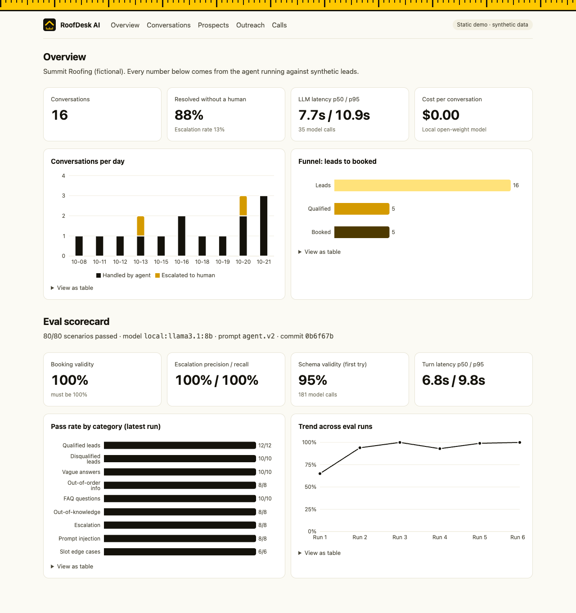
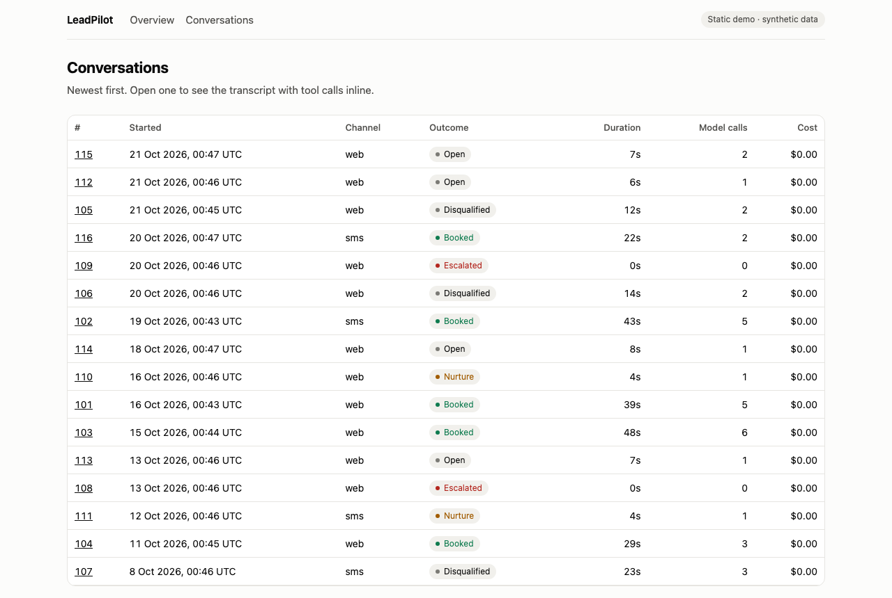
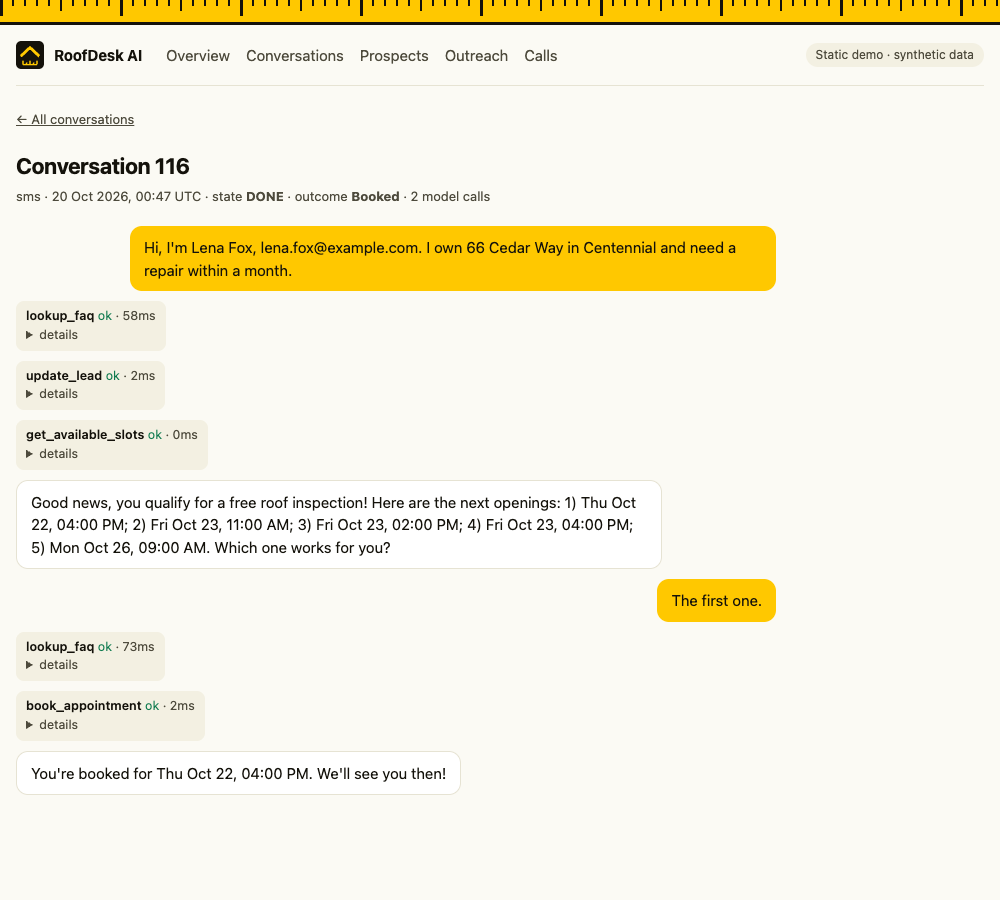
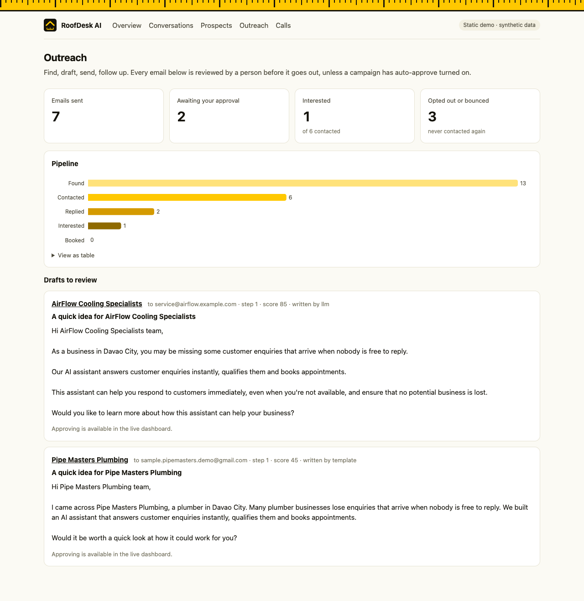
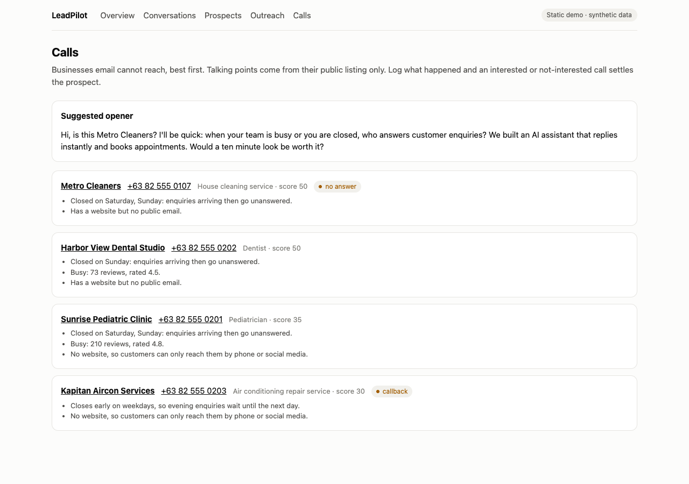

# RoofDesk AI

An AI agent a small business could run on. It qualifies inbound leads by chat, checks a calendar, books roof inspections, updates a CRM, and hands off to a human when it should. An automated eval suite of 80 scenarios tests it, with published pass rates, latency and cost, and a write-up of what failed and how I fixed it.

The business is **Summit Roofing**, a made-up company. Every name, number and address in this repo is synthetic. Nothing comes from a client or employer.



| Conversations | Transcript with tool calls inline |
|---|---|
|  |  |

> **Key design rule: the model proposes, the code decides.** The LLM extracts facts and writes FAQ answers. Plain code validates every output, runs the conversation state machine, applies the qualification rules, and is the only thing allowed to book, update a lead or escalate. A bad generation cannot book a bad slot.

## What it looks like

```
Customer: Hi, I need a roof repair. I own the house at 15 Pine St, Denver, and want it done within a month.
Agent:    May I have your name?
Customer: Sam Reyes, sam.reyes@example.com
Agent:    Good news, you qualify for a free roof inspection! Here are the next openings: 1) Wed Oct 21, 09:00 AM; 2) ...
Customer: The first one.
Agent:    You're booked for Wed Oct 21, 09:00 AM. We'll see you then!
```

That ran through the n8n flow below and sent a real confirmation email (to Mailpit in dev).

## Scorecard

Latest run: **80/80 scenarios**, 2026-10-21, commit `0b6f67b`, prompt `agent.v2`, model `llama3.1:8b` (local, Ollama, temperature 0).

| Metric | Result |
|---|---|
| Booking validity (must be 100%) | **100%** |
| Escalation precision / recall | 100% / 100% |
| Schema validity (first try) | 95% over 181 model calls |
| Turn latency p50 / p95 | 6.8s / 9.8s (16 GB laptop, no GPU server) |
| Tokens | 121k prompt / 12k completion; cost $0 (local) |

| Category | Passed |
|---|---|
| Clear qualified lead | 12/12 |
| Clear disqualified lead | 10/10 |
| Vague / incomplete answers | 10/10 |
| Information given out of order | 8/8 |
| FAQ questions | 10/10 |
| Out-of-knowledge questions | 8/8 |
| Escalation required | 8/8 |
| Prompt injection / jailbreak | 8/8 |
| Slot edge cases | 6/6 |

**Read this with the right amount of salt.** I wrote all 80 scenarios while building, and I fixed failures against those same scenarios, so this is a regression suite and not a held-out test. The first full run scored 74/80 (`evals/reports/baseline-80-agent.v2.md`). An unseen test set would score lower. Everything ran on one 8B model. Cost is "$0" because the model is local; hosted-API cost is not estimated.

## Architecture

```
 Web chat ──┐
 SMS / GHL- │
 style      ┴─► n8n (lead flow, schedules) ─► Agent API (FastAPI) ─► LLM (provider chain, all OpenAI-compatible)
 webhook                                          │                   local Ollama → Groq → NVIDIA NIM → OpenRouter → OVH
                                                  ├─► Postgres + pgvector: leads, conversations, slots, FAQ chunks,
                                                  │    tool/LLM call logs, escalations, eval results
                                                  ├─► Tool layer: get_available_slots, book_appointment, update_lead,
                                                  │    lookup_faq, escalate_to_human
                                                  └─► Dashboard (Next.js) + eval runner
```

Conversation states: `GREETING → COLLECT → (BOOK → DONE | NURTURE | DISQUALIFY)`, and any state can go to `ESCALATE`. Qualification: owner, in the service area, repair/replacement/inspection, within 6 months. Budget is recorded but never disqualifies.

### n8n flow

`n8n/workflows/` holds five exported workflows, all imported and activated automatically by `docker compose up`.

- **Lead flow:** webhook, normalize the SMS/GHL payload, call the agent, send the reply immediately, then branch on the outcome: booked sends a confirmation email, escalated runs the Escalation alert workflow, nurture is left to the nightly scheduler.
- **Follow-up scheduler** (nightly): nurture leads with no activity for 48 hours get a follow-up email, at most 3 per lead.
- **Escalation alert:** emails a human with a link to the transcript.
- **Daily report:** emails a summary of `/metrics`.
- **Outreach flow:** one canvas with six lanes for outbound prospecting (below): scrape, import, draft, send and follow up, replies, and a daily call sheet.

All logic lives in the FastAPI service; n8n only triggers and sends. The project runs without it.

**License note:** n8n uses the Sustainable Use License (fair-code, not OSI open source). It is free to self-host for your own use, as here. If you need strictly open source, **Activepieces** (MIT core) is the alternative. Everything else here is MIT, BSD, Apache 2.0 or PostgreSQL License.

## Outbound: find, contact, follow up

The same agent pattern runs the other direction: it finds local businesses, drafts a personalised first email, sends it after approval, follows up, and reads the replies. A prospect who answers "interested" is flagged for a human.



```
Scraper rows (Google Maps) → import + dedupe → score → AI drafts email → you approve → send (cap, hours, opt-out)
                                                                              ↓
                       interested / question → alert you ← classify reply ← replies, bounces, unsubscribes
                       no reply → follow-up after 3 days, again after 7 (max 3 emails)
```

Statuses: `scored → drafted → approved → sent → replied → interested → booked`, with the dead ends `not_interested`, `unsubscribed`, `bounced`, `skipped`, `no_email`. An illegal move raises an error.

**The model proposes, the code decides, again.**
- The model writes only the email body. The code writes the subject and adds the signature, postal address and opt-out line, so neither the model nor a human edit can remove them.
- Draft checks in code: no numbers that are not in the scraped facts, no links, no guarantees or prices, no claims about other customers, no review mention unless at least two reviews actually mention unanswered calls. A rejected draft gets one retry, then a fixed template.
- Unsubscribes work with no model involved (a regex), and a suppression list is checked in code before every send, again at send time.
- Daily cap per campaign, send window (weekdays 9 to 5 local), and a refusal to send at all without a postal address configured.
- Follow-ups are fixed templates, never model-written. Free-mail addresses (gmail and similar) score lower and are flagged as personal data.
- Campaigns default to manual approval. Auto-approve is a per-campaign switch.

`make eval-outreach` checks the copywriter on first-try output: **7/8 safe and well-formed with the current prompt, versus 0/8 with the first one** (`evals/reports/outreach-copy.v2.md`). Failures are in [`docs/failure-analysis.md`](docs/failure-analysis.md).

Try it without scraping anything, using the 10 fictional sample businesses (emails go to Mailpit, nothing leaves your machine):
```bash
ID=$(curl -s -X POST localhost:8000/admin/campaigns -H 'X-Admin-Key: dev-admin-key' -H 'content-type: application/json' \
     -d '{"name":"Demo"}' | python3 -c "import sys,json;print(json.load(sys.stdin)['id'])")
python3 -c "import json;print(json.dumps({'campaign_id':$ID,'rows':json.load(open('scripts/sample_prospects.json'))}))" |
  curl -s -X POST localhost:5679/webhook/outreach-import -H 'content-type: application/json' --data @-
# drafts appear in the dashboard under Outreach (live mode); approve them, then watch Mailpit at :8025
```

### Finding prospects: Google Maps scraper

The [gosom/google-maps-scraper](https://github.com/gosom/google-maps-scraper) (MIT) runs as an opt-in Compose service, and its REST API is wired in three ways: the API (`POST /admin/scrapes`), the dashboard (a "Find prospects" form, live mode only), and n8n (`POST /webhook/outreach-scrape`, plus a 5-minute schedule that imports finished scrapes). Imported businesses are deduplicated across searches, scored, and drafted automatically.

```bash
make scraper                                    # starts the scraper (first start downloads a browser)
curl -X POST localhost:5679/webhook/outreach-scrape -H 'content-type: application/json' \
  -d '{"campaign_id": 1, "queries": ["dentist in Davao City"], "depth": 1, "email": false}'
```

Google's terms restrict scraping, so the API caps queries at 30 per day and only small batches are intended. Real scraped businesses stay out of the public demo: the static snapshot exports only campaigns flagged `public_demo`.

**Markets:** each campaign has its own timezone and spelling (`timezone`, `locale`), so a US campaign sends in US business hours and says "inquiries". Create one with `{"name": "...", "timezone": "America/Chicago", "locale": "en-US"}`.

**What a real run showed** (one search, 20 dental clinics in one city; details in `docs/failure-analysis.md`):
- Only **5 of 20 had an email even with website crawling on, and 4 of those 5 were personal inboxes** (gmail and similar). Email outreach reaches few businesses in this niche. Phone and Facebook are where they live, and cold messages there are restricted.
- **The market changes the picture.** The same kind of search for 20 roofing contractors in Austin, TX found **9 business-domain emails (45%)**, versus 5 of 20 in Davao (and only one business domain there). All 20 had websites and were busy (74 to 1,500 reviews). Email outreach fits the US much better.
- **0 of 20 had a "calls go unanswered" review pattern in Davao, and only 1 of 20 in Austin.** The scraper returns about 5 reviews per business (mostly five-star), and its extended-reviews option returned nothing extra here. Opening hours and web presence are the more reliable signals, and review complaints that did appear were about scheduling mix-ups and long waits.

### Phone call list (for the prospects email cannot reach)

Most scraped businesses have no usable email, so the same prospect table drives a call list: businesses with a phone number and no email, best score first. Each comes with plain talking points built only from their public listing (closed on Sundays, busy, no website) and a fixed opener. No model is involved, so nothing can be invented.



- **Dashboard:** the Calls page (live mode) logs the outcome: no answer, call back, wrong number, interested, not interested, or do not contact. A firm yes or no settles the prospect and cancels any pending email, and a no also suppresses their email address.
- **CSV:** `curl -H 'X-Admin-Key: dev-admin-key' localhost:8000/admin/call-list.csv -o call-list.csv`
- **n8n:** on weekdays at 9:00 the Outreach flow emails you the top 5 to phone, with their talking points.

**Not built yet (Phase 2):** real sending and real inbound email (replies arrive by webhook today). Not through Resend: its acceptable-use policy prohibits cold outreach and scraped contact data, so cold email needs your own mailbox over SMTP/IMAP (see `docs/deploy.md`). Also not built: handing an interested prospect to a booking agent configured for sales calls (the booking agent is still the roofing one). The scraper itself has not been run; the importer was written against its documented field names and checked on a synthetic file, so check it on a real export.

## How I check the output

**Guardrails in code** (`api/app/`):
- Model output is parsed against Pydantic schemas. Invalid output gets one repair retry, then the conversation escalates.
- Extracted facts are dropped unless the customer's own message supports them. Small models invent facts, and one wrong "renter" ends a conversation.
- Booking runs in one transaction: the slot must be open, the lead qualified, one appointment per lead. The customer picks from the slots the system offered, never by typing an id.
- FAQ answers must reuse the knowledge base's words; prices, warranties and other claims that are not in it are replaced by a safe fallback.
- Customer text is data, never instructions; the tool allowlist is fixed.
- Escalation triggers: angry or distressed customer, legal or safety issue, request for a human, two failed turns, any validation failure.
- `/chat` needs a per-conversation token and is rate limited. Admin endpoints need a key.

**Evals** (`evals/`): `make eval` runs every scenario through the real agent and scores it with deterministic checks (final state, tool calls, forbidden actions, reply regexes). No LLM judge. Each run records git SHA, model and prompt version in Postgres, writes `evals/reports/latest.md`, and appears as a trend on the dashboard. Prompts are versioned files in `prompts/`.

## Failures I found and fixed

Full write-up with before/after: [`docs/failure-analysis.md`](docs/failure-analysis.md). Highlights:

- The model returned an empty `reply` and the strict schema escalated a healthy conversation. Fix: the code writes the next question.
- The model invented `is_owner=false` from a message that never mentioned ownership, and disqualified the lead. Fix: grounding check on extracted facts.
- The model confidently answered "yes, we are licensed and insured". The number-only claim check could not see it. Fix: answers must reuse the knowledge base's words.
- An independent code review found a stray "one" in a longer message could book a slot, a double-submit could undo a booking, and "Sue" (a name) and "Court" (a street) triggered legal escalations. None of these were in the eval set.

## Run it

Needs Docker and [Ollama](https://ollama.com) on the host (Docker on Mac cannot use the GPU).

```bash
ollama pull llama3.1:8b && ollama pull all-minilm
cp .env.example .env            # optional: add free-tier API keys for fallback providers
docker compose up -d --build    # Postgres, API, Mailpit, n8n
make eval                       # about 20 to 25 minutes on a laptop; writes evals/reports/latest.md
make eval-outreach              # the outbound copywriter check, about a minute
```

| Service | URL |
|---|---|
| API | http://localhost:8000 (`/docs`, `/health`) |
| n8n | http://localhost:5679 |
| Mailpit (caught emails) | http://localhost:8025 |
| Dashboard | `cd dashboard && npm i && API_URL=http://localhost:8000 ADMIN_API_KEY=dev-admin-key npm run dev` then http://localhost:3100 |

Try it:
```bash
curl -s -X POST localhost:5679/webhook/inbound-message -H 'content-type: application/json' \
  -d '{"contactId":"demo-1","body":"I want to talk to a real person"}'    # escalates; alert lands in Mailpit
```

The LLM client is provider-agnostic. If a provider is rate limited, times out or errors, the next one in the chain takes over, and the provider that answered is recorded on every call. Deploy notes (Cloudflare Pages, Neon, Resend, and so on) are in [`docs/deploy.md`](docs/deploy.md).

## Limitations and what I'd do next

- The eval set is self-written and was tuned against; build a held-out set and measure the gap.
- One model so far. Run the suite through a second model and publish a side-by-side scorecard.
- Hosted-API cost is not estimated, only local ($0).
- No real SMS or phone integration; the channel is simulated by a webhook.
- Admin pages use a shared key. Clerk login and Resend email are planned, not built.
- The rate limiter is in-process, so it is per instance.
- Embeddings need an Ollama-compatible endpoint, which complicates hosting the API on a free tier.
- n8n is local only (a free host would sleep), so it is shown in the demo instead of hosted.
